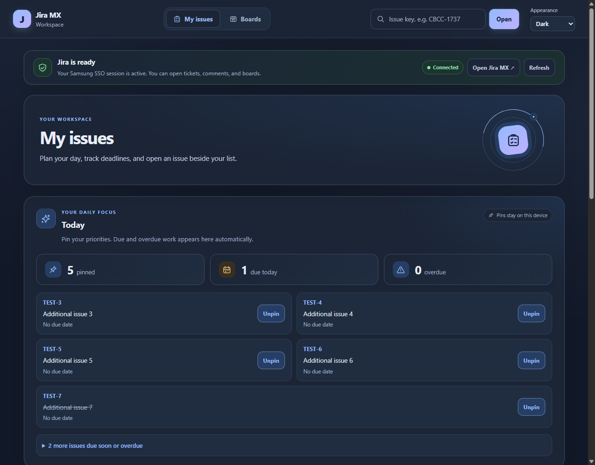
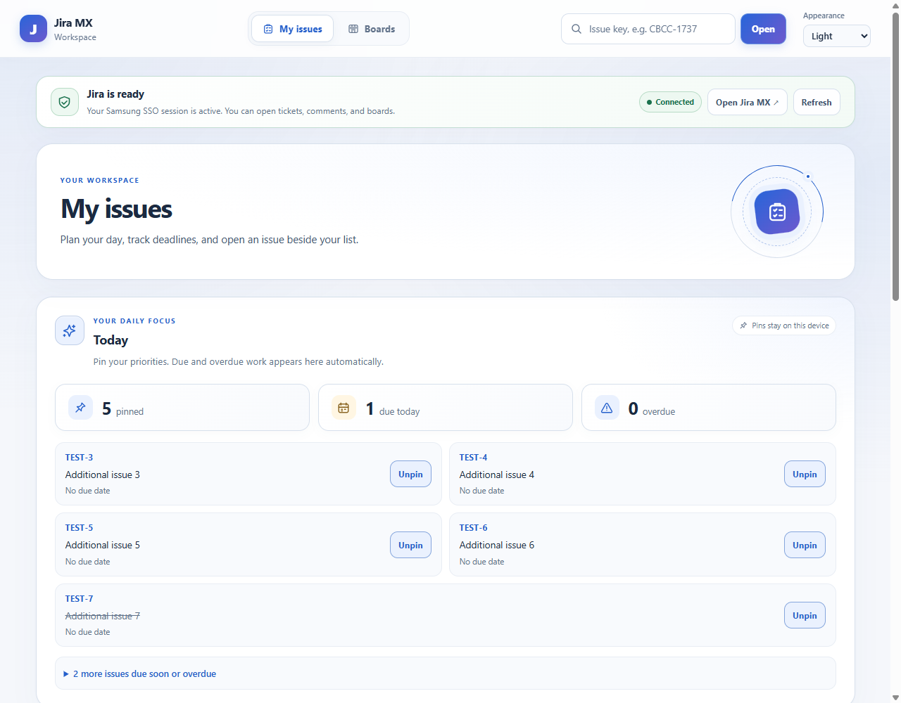
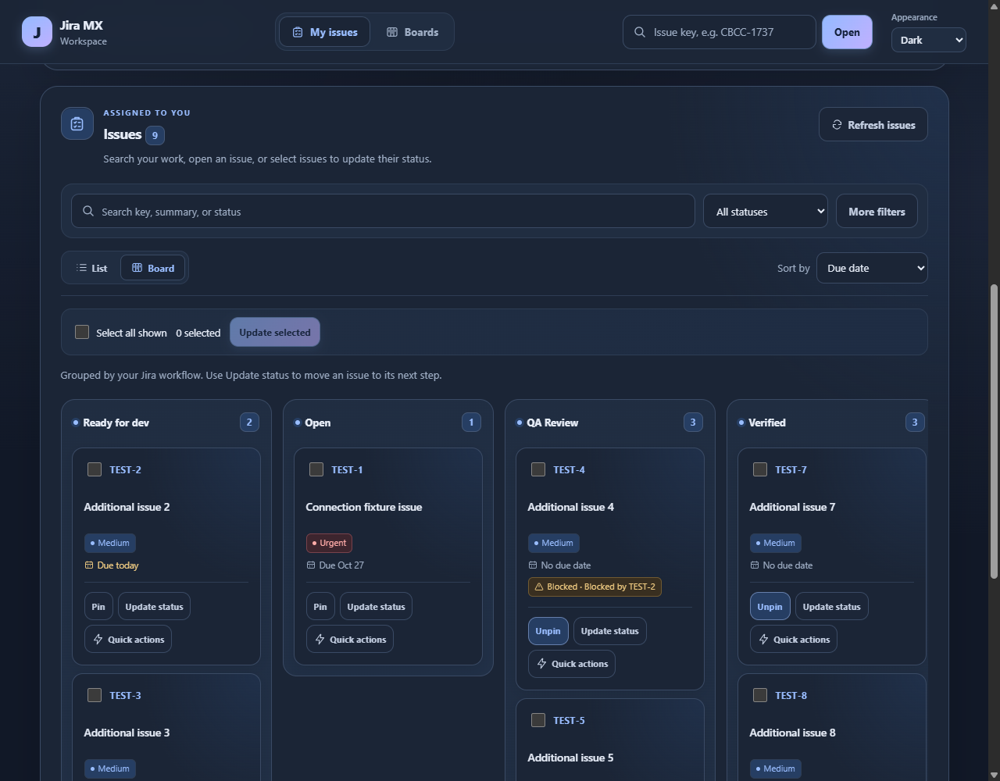
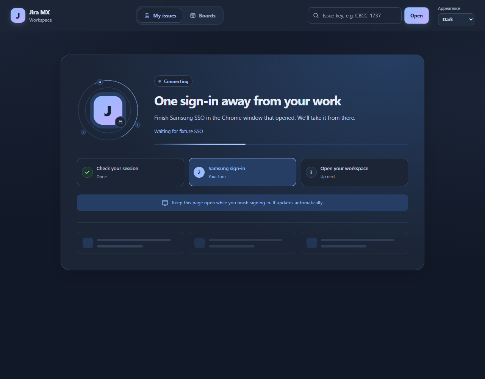

# Jira MX Workspace

A local task-management workspace for Jira MX: plan your day, track deadlines and blockers, read conversations, and update work from a single interface. The workspace has matching light and dark themes, responsive layouts, and an animated sign-in experience.

Jira access uses the installed **managing-jira** skill and your Samsung SSO browser session. The app does not require a Jira PAT or an AI provider API key, and does not call Jira REST directly.

## What you can do

- Open an issue by key or browse issues assigned to you.
- Use **Today** to pin up to five priorities and see overdue work, today's deadlines, and work due in the next seven days. Completed issues are excluded from deadline alerts.
- See priority, due dates, and blocker reasons in each issue row, and sort by recent updates, due date, priority, or summary.
- Open an issue in a side panel while keeping your list filters, selection, and paging. On phones the preview opens as a dialog; **Open full issue** shows the complete issue page.
- Use **Quick actions** to add a comment, change priority, or set/clear a due date. Review the exact change and confirm before it is sent to Jira MX. Priority choices and editable dates come from that issue's Jira configuration.
- Switch between **List** and **Board** in My issues. Board columns use the actual Jira status names, and selection is shared between layouts. Use **Update status** to move work through its workflow.
- Filter assigned issues by status, project, label, priority, or update date, and save filter views on this device.
- Open an issue to read its full comment history, with no date limit or ten-comment cutoff. Search the conversation by author or text, and sort by date.
- Choose **System**, **Light**, or **Dark** from **Appearance**. Your choice is remembered on this device, and System follows your operating system preference.
- Follow connection progress through session checks and Samsung sign-in. The loading screen replaces inactive controls, survives navigation and reloads, and offers sign-in help when needed. Animations respect reduced-motion preferences.
- Read issue descriptions, comments, links, attachments, dates, status changes, watchers, work logs, and available transitions.
- Find Jira boards and active sprints.
- Update an issue status from its row or detail view, or select multiple issues and choose **Update selected**. Choose a shared status or a transition per issue, then review and confirm. Selection spans pages and resets when filters change.

## Preview

Screenshots show local test fixtures, not live Jira data.



<details>
<summary>Light mode, workflow board, and sign-in progress</summary>







</details>

## Windows app (recommended for end users)

Download the team's `Jira-MX-Workspace-win-*.zip`, extract the entire ZIP, and double-click **Jira MX Workspace.exe**. Node.js and the built app are included; users do not need npm or the source repository. The app opens at <http://127.0.0.1:43821> in your default browser. Create a shortcut to the EXE for daily use.

Python 3.10+, Chrome/Edge, and the organization's approved **managing-jira** skill and its dependencies must still be installed on each user's computer. The package does not include that separately managed skill, credentials, `.env` settings, or browser profiles. See [Windows first-use instructions](docs/WINDOWS-QUICKSTART.txt).

The app stays in the Windows notification area when you close the browser tab. Double-click its icon to reopen, or right-click and choose **Quit** to stop the local server. Startup logs are under `%LOCALAPPDATA%\Jira MX Workspace\launcher.log`. This portable release uses Windows .NET Framework 4.x for its launcher and the architecture of the Node.js runtime used to build it.

### Build the Windows distribution

On Windows with Node.js 20+ and npm installed:

```powershell
npm ci
npm test
npm run package:windows
```

The command builds the UI/API, installs only API production dependencies from the lockfile in a fresh staging folder, includes the current Node executable and its license notices, compiles the native Windows launcher, runs a local packaged-runtime smoke test, and creates a ZIP and SHA-256 checksum in `release/`. Internet access is needed for npm dependencies and the matching Node license. The launcher compiler included with Windows .NET Framework must be available. Build with an x64 Node installation for an x64 release.

Share the complete ZIP and checksum. The EXE needs its adjacent runtime, app, and dependency folders. Builds are unsigned; use your organization's approved distribution and signing process. `npm run test:package` repeats the runtime smoke test against the latest staged build without accessing Jira. Build files and archives are ignored by Git.

The native launcher uses a single instance, checks that its own server is ready before opening the browser, and stops the server when it exits. Port `43821` is fixed for the Windows app so browser preferences remain associated with the same address. A port conflict produces a startup error. `.env` can override Python/skill paths; the launcher's port takes precedence over `PORT`.

## Development requirements

- Node.js 20 or newer and npm.
- Python 3.10 or newer. Windows uses `py -3` by default; other systems use `python3`.
- Chrome or Edge available to managing-jira for the managed SSO browser session.
- The managing-jira skill at `~/.agents/skills/managing-jira` or `~/.codex/skills/managing-jira`. Set `MANAGING_JIRA_SKILL_PATH` if it is elsewhere.
- Access to Jira MX with your Samsung SSO account.

## Run from source

```powershell
npm ci
npm run doctor
npm run dev
```

Open the Vite URL shown in the terminal, normally <http://localhost:5173>. On Windows, `start-jira-copilot.cmd` also starts the app.

### Optional configuration

Defaults work without a `.env` file. If you need overrides, copy `.env.example` to `.env` in the repository root.

| Variable | Default | Purpose |
| --- | --- | --- |
| `PORT` | `3001` | Local API port. If changed, update the proxy target in `apps/web/vite.config.ts` too. |
| `MANAGING_JIRA_SKILL_PATH` | Auto-discovered in `~/.agents/skills` or `~/.codex/skills` | Absolute path to the installed managing-jira skill. |
| `MANAGING_JIRA_PYTHON` | `py` on Windows, `python3` elsewhere | Python executable path or command, without additional arguments. |

The managing-jira skill is installed separately. The app reuses its configured Jira MX site and browser profile.

## First use

1. Select **Connect Jira**. The managed Chrome window opens directly at `https://jira-mx.sec.samsung.net/login.jsp`.
2. Complete Samsung SSO in that window if prompted. The app updates when Jira MX is ready.
3. Follow the animated connection steps. You can navigate or reload while connecting; the app follows the existing sign-in attempt.
4. In **My issues**, pin your priorities in **Today**, choose **List** or **Board**, and sort or filter your assigned work. Text searches update immediately; choose **Apply filters** after changing other filters, or **Clear filters** to reset them.
5. Select an issue to open its preview beside the list. Choose **Open full issue** for the complete page, or enter an issue key in the header to open it directly.
6. Use **Update status**, **Update selected**, or **Quick actions** to make a change. Review the target issue and exact change before confirming. Use **Boards** to find team boards and active sprints.

If Chrome stays on **New Tab**, open `https://jira-mx.sec.samsung.net/login.jsp` in that same managed Chrome window. If you have already signed in but the app still says Connecting, use **Check connection** after the attempt ends.

The skill keeps the managed browser running so the session can be reused. Jira MX is fixed as the only site.

Session checks are reused for up to 15 seconds, including immediately after login, to
avoid repeated browser probes while loading work. Refresh and Check connection always
request a fresh check. Failed Jira requests clear the cached session result.

Refreshing the page restores the last verified connection state from this tab for
up to five minutes while the API checks the existing session in the background.
This stores UI status only; Jira requests still validate the real SSO session.
Session expiry and validation errors clear the saved state. The sign-in animation
appears only during a login attempt, rather than on every page refresh.

## Privacy and limits

- The local API listens on `127.0.0.1`.
- Jira reads and changes go through managing-jira and respect your Jira permissions. Status changes, comments, priority changes, and due date changes require review and confirmation in the app.
- Batch updates report each issue separately; successful changes are not rolled back if another issue fails. Connection failures stop remaining updates. An uncertain result must be checked in Jira before retrying.
- Status choices come from each issue workflow. Transitions requiring extra fields must be completed in Jira.
- Pins, saved filters, sort order, layout, and comment seen state stay in this browser. Pins are personal and do not change Jira.
- Blocker badges reflect blocked statuses, blocked/impediment labels, or inward blocking issue links. Completed blockers are excluded when their status is available; a missing linked status is explicitly shown as unavailable.
- Comments load when you open an issue. Assigned issue searches follow Jira pagination.
- Some insight sections may be unavailable if a Jira project or plugin does not grant access.

## Development

Use Node.js 22 or newer for the browser fixture scripts, which use Node's built-in WebSocket client. The app itself supports Node.js 20 or newer.

```powershell
npm test
npm run build
node scripts/test-connection-browser.mjs
node scripts/test-status-browser.mjs
py -3 scripts/test-jira-login.py
py -3 scripts/test-jira-workspace.py
```

Connection tests cover closed and existing sessions, duplicate login requests, concurrent reads,
incomplete SSO, timeout recovery, expired sessions, invalid CLI output, missing Python/skill,
HTTP errors, and refreshing Jira views after reconnecting. The browser scenarios also cover animated connection progress, reduced motion, theme and pin persistence, complete issue comment threads, sorting, preview state, quick action review and updates, workflow board layout, filter reset, restoring older saved navigation, and mobile/tablet/desktop layouts. The browser scenario test uses
the built UI, local simulated Jira responses, and an isolated temporary headless Chrome/Edge
profile. Set `BROWSER_PATH` if the browser is installed elsewhere.

To regenerate the documented screenshots on Windows, run the built UI fixture test with an output directory:

```powershell
$env:UI_SCREENSHOT_DIR = Join-Path $env:TEMP 'jira-workspace-previews'
New-Item -ItemType Directory -Force -Path $env:UI_SCREENSHOT_DIR | Out-Null
node scripts/test-connection-browser.mjs
```

The fixture test also captures task previews, quick-action dialogs, team boards, and phone-sized connection screens. Review generated images before adding them to the repository.

Status tests cover single and batch updates, workflow-specific transitions, validation, partial failures, expired sessions, and uncertain write outcomes. The status browser scenarios also check selection across pages, confirmation, refreshed statuses, and mobile layout using local fixtures.

These tests do not perform Samsung SSO against live Jira. Use **Connect Jira** for the live
check. Login progress is held by the local API; restarting that process clears the attempt.
The managed browser remains open, and **Check connection** can detect a completed sign-in.

The app uses `scripts/jira-login.py` for login only. It runs the installed managing-jira
CLI with a process-local navigation fix: Chrome receives the configured login URL at
startup, and fresh Jira tabs open that login URL rather than the anonymous homepage.
The installed skill files and browser profile are reused.

Task reads use `scripts/jira-workspace.py`, a process-local adapter that preserves task fields and workflow categories in the installed CLI's output. The CLI still performs all authentication, site checks, and Jira requests; the installed skill is unchanged.

On Windows, run the login navigation regression tests with:

```powershell
py -3 scripts/test-jira-login.py
$env:JIRA_LOGIN_BROWSER_TEST = '1'
py -3 scripts/test-jira-login.py -v
```

The optional browser test uses an isolated temporary Chrome profile and a local HTTP
fixture; it does not sign in to Samsung SSO.
